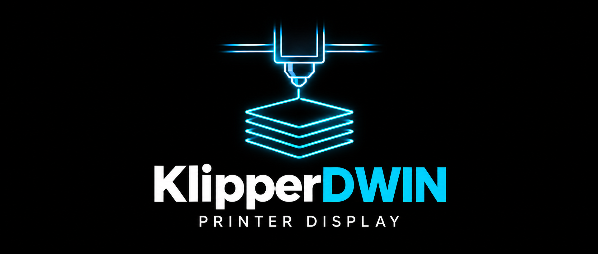

<p align="center">
  
</p>

**Control your Klipper printer from a DWIN display and rotary encoder.**

Browse prints, preview a model, adjust the printer, level the bed and manage a Happy Hare MMU without opening the web interface.

[English](README.md) · [Türkçe](README_TR.md)

<p align="center">
  <a href="https://github.com/sezgynus/KlipperDWIN/tree/v2.0.0"></a>
  
  
  <a href="LICENSE"></a>
</p>

<p align="center">
  
  
  
</p>

## Features

| What you want to do | What is available |
|---|---|
| Choose a print | Nested folders, Mainsail sorting, model preview, estimated time, filament usage and tool changes |
| Manage a print | Progress and time, Pause/Resume, Stop, speed, temperature, fan, runtime Z offset and flow monitoring |
| Prepare the printer | Homing, stepper release, XYZ/extruder movement, Live jog, preheat presets and cooldown |
| Calibrate the bed | Four-corner screw adjustment, probe-offset calibration, bed mesh measurement and saved mesh viewing |
| Manage an MMU | Happy Hare gates, load/unload, bypass, tool mapping, EndlessSpool, recovery, maintenance, LEDs and multiple units |
| Inspect filament | Gate material/color, spool assignment and Spoolman remaining percentage when available |
| Adjust the display | Brightness, idle dimming time and dimmed brightness, retained across power cycles |
| Control lighting and power | PWM case light, encoder hold to power on and a power-off confirmation |
| Check the system | Network/Wi-Fi, host and MCU status, software versions, project QR code and KlipperDWIN updates |
| Create screenshots | Optional emulator capture for documentation and bug reports |

Optional controls appear according to the printer's configuration. The on-screen menu labels are in English in both guides. These documents describe the current `master` version.

## Requirements

- A **272×480 DWIN T5UIC1** panel, such as the compatible 4.3-inch Ender 3 V2 display, with matching panel resources.
- A Raspberry Pi or compatible Linux SBC with UART/GPIO and **Python 3.11 or newer**.
- A working **Klipper and Moonraker** installation.
- Optional: Mainsail for shared sorting/temperature presets, Happy Hare for MMU controls, Spoolman for spool information, and a configured Moonraker power device.

DWIN, DACAI and TJC panels are not interchangeable. Check [display compatibility](docs/lcd-assets.md) before installation.

## Installation

Follow the [installation and configuration guide](docs/installation.md) for wiring, serial setup and connection settings. Clone into the installation user's home directory:

```bash
cd ~
git clone https://github.com/sezgynus/KlipperDWIN.git
cd ~/KlipperDWIN
./install.sh
```

The installer sets up dependencies, the service and Moonraker Update Manager. To change connection, encoder or power settings later, run `./configure.sh` from `~/KlipperDWIN`.

## Getting started

Rotate the encoder to navigate; press to select. For a numeric setting, press, rotate and press again to confirm. **Back** returns to the previous menu. Home has multiple pages; keep rotating to reach the next page.

| Home entry | Where it takes you |
|---|---|
| Print | File browser and print preview |
| Prepare | Movement, homing, preheat and cooldown |
| Control | Temperature, runtime motion limits and case light |
| Leveling | Bed mesh calibration, mesh viewer, screw adjustment and probe calibration |
| MMU | Happy Hare filament controls and recovery |
| Display | Brightness and idle dimming |
| Info | System status, software versions and updates |

Leveling and MMU depend on configured capabilities. During startup, a progress bar shows the current preparation stage; wait for Home before navigating. Hold-to-power-on remains available while waiting.

## User guides

| Guide | Contents |
|---|---|
| [Installation and configuration](docs/installation.md) | Wiring, installation, settings, updates and troubleshooting |
| [Daily use](docs/user-guide.md) | Print workflow, Live jog, temperatures, calibration, Display, Info, lighting and power |
| [MMU and filament](docs/mmu-guide.md) | Gates, spool IDs, tool mapping, EndlessSpool, bypass, recovery and options |
| [Documentation index](docs/README.md) | All user guides, contributor tools and optional references |

The guides include the current emulator screenshots. See [Display](docs/user-guide.md#display-settings), [Info and updates](docs/user-guide.md#info-and-updates) and [screw adjustment](docs/user-guide.md#screw-adjustment) for the recently added screens.

## Important usage notes

- Motion limits and runtime Z offset apply to the current session; they do not replace permanent printer/probe calibration.
- Screw adjustment requires a probe and four distinct corner screws configured in Klipper.
- Viewing a mesh does not activate it. Saving calibration restarts Klipper; stopping a running mesh measurement puts Klipper into shutdown.
- MMU calibration and advanced LED effects remain in the web interface. Available LCD actions depend on the installed Happy Hare configuration.
- A failed or unconfirmed action should be checked in Mainsail before you repeat it.

## Development and contributing

See [CONTRIBUTING.md](CONTRIBUTING.md) for bug reports, pull requests, tests, screenshot capture and the icon preparation tool. The [emulator guide](docs/ui-emulator.md) explains how to enable capture and save original-size images from the running service.

## Credits and license

This project grew from [odwdinc/DWIN_T5UIC1_LCD](https://github.com/odwdinc/DWIN_T5UIC1_LCD) and [bustedlogic/DWIN_T5UIC1_LCD](https://github.com/bustedlogic/DWIN_T5UIC1_LCD). Original copyright notices and Git history are retained.

Integrations use [Klipper](https://github.com/Klipper3d/klipper), [Moonraker](https://github.com/Arksine/moonraker), [Mainsail](https://github.com/mainsail-crew/mainsail), [Happy Hare](https://github.com/moggieuk/Happy-Hare) and [Spoolman](https://github.com/Donkie/Spoolman).

Licensed under **GNU GPL v3.0**; see [LICENSE](LICENSE).
