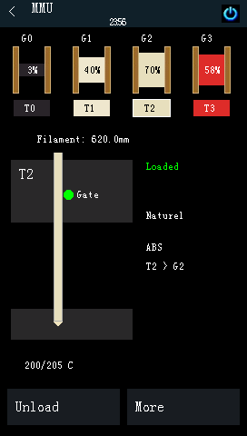
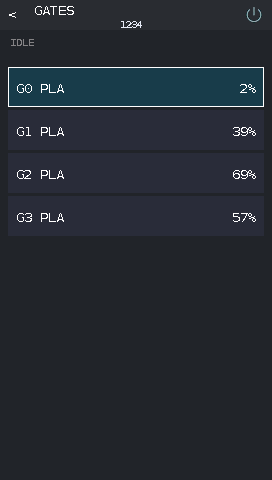
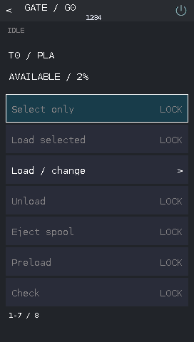
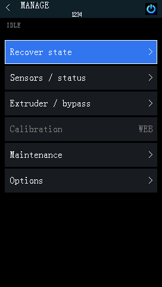
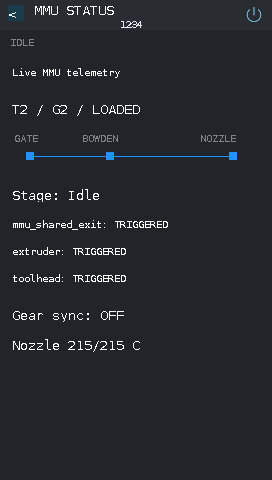
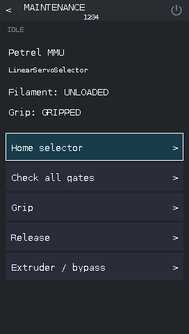
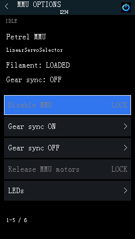

# MMU and filament

[English](mmu-guide.md) · [Türkçe](mmu-guide_TR.md) · [Documentation](README.md)

## Open the MMU menu

With a configured Happy Hare MMU, select **Home → MMU**. Home also shows gate colors and, when Spoolman data is available, remaining filament percentages. Missing Spoolman information does not prevent other MMU functions.

  
  
  

Rotate to select; press to open. Browsing gates or details does not move filament. **G1 is Happy Hare gate 0**; logical tools retain T0-based numbering. `T*` means several tools share that gate.

Actions open a confirmation showing the target, with **Cancel initially selected**. Routine movement and edits require an idle MMU outside printing/pauses. Unsupported options are hidden; actions may be locked when the printer state is busy, unknown or unsuitable. Check the actual printer before retrying a failed/unconfirmed operation.

## Gates and loading

Open **MMU → Gates → [gate]**:

| Action | Use |
|---|---|
| Select only | Select the physical gate; the selector may move |
| Load selected | Load filament from that gate |
| Load / change | Use a logical tool associated with the gate and its Happy Hare mapping |
| Unload | Park loaded filament back in the MMU |
| Eject spool | Remove filament from the MMU, unloading the active gate first if needed |
| Preload | Prepare the gate's filament using Happy Hare |
| Check | Check the selected gate |
| Filament details | View name, material, color, spool ID, remaining percentage, temperature and Spoolman mode |

Confirm the gate/tool named on the screen before accepting. The MMU Home Load/Unload shortcut operates on the current gate.

## Spool assignments

Open **Gates → [gate] → Filament details → Assign spool ID**. Press **Spool ID**, rotate to the positive numeric ID, press to accept the edit, then choose **Save** and confirm. **Cancel** discards the draft. Use **Clear assignment** to remove an assignment explicitly.

Assignment depends on the configured Spoolman mode: known `off`, `readonly` and `push` modes allow local edits; `pull` and unknown modes remain locked. Required filament information must be available. A duplicate-ID warning means the ID will move from another gate. Confirm the spool exists and inspect Spoolman afterwards if synchronization is expected.

## Tool map

Open **MMU → Tool map**. Select a tool, press, rotate to its gate and press to accept. Repeat for other tools, then **Save** and confirm, or **Cancel** to discard the draft. Several tools can share one gate.

Make edits while idle and outside printing/pauses. If the mapping changes from the web UI during editing, reopen the editor before continuing.

## EndlessSpool

From **Tool map**, open **EndlessSpool**. It groups compatible replacement spools so Happy Hare can continue when a spool runs out.

1. Press **Enabled**, rotate and press to accept the desired state.
2. Open a group and press gates to add/remove membership. Removing a member gives it a separate group; the last member stays.
3. Check the displayed material/color compatibility and the physical spools.
4. Choose **Save** and confirm, or **Cancel** to discard the draft. Back from a member page keeps the draft.

Make changes while idle and outside printing/pauses. Matching metadata is a guide; verify the actual filament is suitable for substitution.

## Bypass

Open **MMU → Bypass**. First **Unload current gate**, then **Select bypass**. Use **Load extruder** and **Unload extruder** for the extruder-only filament path. Confirm each operation. Bypass selection requires unloaded filament.

## Recovery and status

  
  

An MMU error pause with a reported reason opens recovery automatically. You can also use **MMU → Manage → Recover state**.

1. Read the error and fix the physical filament problem.
2. Use recovery, or the manual state editor to report the actual gate/tool/filament state. Manual Apply reports state; it does not load or unload filament.
3. Unlock/reheat if needed.
4. Choose **Resume** separately once the print is paused, the MMU is unlocked and filament is loaded.

**Status** / **Sensors / status** shows the current action, available Bowden-stage progress, sensors, gear sync, nozzle temperature and operation result. Bowden percentage describes that stage, not the whole tool change. `CLEAR`, `TRIGGERED`, `UNKNOWN/OFF` and `ABSENT` distinguish sensor conditions.

## Maintenance and options

  
  

Open **Manage → Maintenance** or **Manage → Options**. Controls depend on the installed Happy Hare configuration and reported state:

| Page / option | Use and prerequisite |
|---|---|
| Maintenance → Check all gates | Check every configured gate |
| Maintenance → Home selector | Available for a supported single linear-selector unit; confirmation identifies the tool selected afterwards |
| Maintenance → Grip / Release | Supported selector grip control with unloaded filament; Release is omitted for always-gripped units |
| Options → Gear sync ON/OFF | Synchronize MMU gear and extruder with loaded filament; always-gripped units cannot unsync |
| Options → Enable/Disable MMU | Requires unloaded filament outside printing/pauses; enabling resets Happy Hare state |
| Options → Release MMU motors | Release the MMU motors when supported; requires unloaded filament outside printing/pauses and may lose homing |
| Options → LEDs | Active-unit on/off, animation and exit modes: Off, Gate status, Filament color or Slicer color |
| Options → Units | Browse multiple units and their global gates; Select this unit separately confirms selection of its first gate and may move/home the selector |

Units is omitted for single-unit installations. Unit selection needs unloaded filament outside printing/pauses. LED options require supported active-unit LED information. Use the web interface for **MMU calibration, custom LED effects and entry/status/logo LED configuration**.
