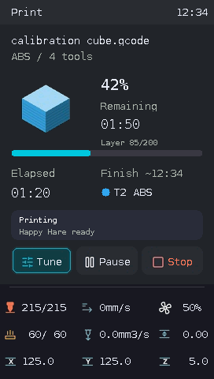

# Print and Tune controls



The Print screen shows the cached G-code thumbnail, progress, elapsed/remaining time, estimated finish time and optional layer information reported by `print_stats.info`. It keeps the compact live dashboard. Thumbnail conversion and download happen off the UI thread; only bounded SRAM uploads and changed fields are sent to the panel. Print thumbnails use an 88 × 88 baseline 4:2:0 JPEG and the existing protected-black transparency policy.

Rotate the encoder to select Tune, Pause/Resume or Stop. Pause and Resume execute directly; Stop opens a confirmation with Back initially selected. Holding the encoder keeps the global power shortcut. Printing and paused jobs block power off; cancel the print first. A numeric Tune draft survives a cancelled power shortcut.

Happy Hare installations show the active tool's mapped gate color/material. During a tool change the source and target use reported `last_tool` / `next_tool` values. Unknown values remain unknown. An MMU lock shows the reason on Print and replaces Resume with MMU. MMU opens a scrollable full error reader and the existing guarded recovery/manual-state pages. Back returns to Print. No MMU means no MMU controls.

Tune uses one screen for Print, Motion, Extrusion and After Job groups. Controls appear only when their device and runtime telemetry are available. Firmware retraction controls require `[firmware_retraction]`; pressure advance and smoothing follow the active extruder. Layer data is optional and is never inferred from height.

Press a numeric field, rotate to edit, then press Apply. Values and switches update optimistically without waiting or success dialogs. An explicit command failure restores the current subscribed value and briefly blinks red twice. A request still awaiting a response is not rejected merely because it is slow. Completed requests are reconciled against subscribed state. Older replies cannot replace a newer edit, and reconnects invalidate pending edits.

## Optional job policy switches

Petrel recognizes these exact three digital output pin names independently:

```ini
[output_pin Turn_OFF_Heaters_After_Job]
pin: virtual_pin:Turn_OFF_Heaters_After_Job_pin
value: 1

[output_pin Disable_Motors_After_Job]
pin: virtual_pin:Disable_Motors_After_Job_pin
value: 1

[output_pin Power_OFF_Printer_After_Job]
pin: virtual_pin:Power_OFF_Printer_After_Job_pin
value: 0
```

`virtual_pin:` requires your installed Klipper virtual-pins extension; it is not a built-in Klipper pin provider. Alternatively use suitable output pins. Petrel does not install an extension or modify macros.

Switching a row sends only `SET_PIN PIN=<exact name> VALUE=0|1`. It does **not** immediately stop heaters, disable motors or power off the printer. Your START_PRINT / END_PRINT macros decide what each pin means. For example:

```jinja

  TURN_OFF_HEATERS


  M84

```

Handle `Power_OFF_Printer_After_Job` in your own end-print power macro using your configured Moonraker power device and cooling policy. Undefined pins, PWM pins and pins without a known digital value are hidden.

Print button normal/selected surfaces and symbols are complete library JPEGs. Selection changes repaint only the old and new button, with one icon and one native label each (four drawing packets); Pause/Resume changes repaint only the middle button. Full strip erasure occurs only when the three-button layout changes to the two-button completion layout.
