# Ekran galerisi

[English](screenshots.md) · [Türkçe](screenshots_TR.md)

Bu görseller güncel Petrel arayüzünden, emülatör aracılığıyla özgün **272×480 RGB PNG** boyutunda üretilmiştir. Yazıcı, sıcaklık, filament ve ağ değerleri örnektir; gerçek bir makineden alınmış ölçümler değildir. İsteğe bağlı menüler yazıcınızın özelliklerine göre görünür.

Forum yazılarında her görselin **PNG bağlantısını** kullanabilirsiniz. Bu `master` bağlantıları, aynı dosya adı korunarak güncellenir. `v4.0.0` gibi bir etikete verilen bağlantı ise o sürümün görselini göstermeye devam eder.

Kullanım adımları: [Günlük kullanım](user-guide_TR.md) · [MMU](mmu-guide_TR.md). Görüntü alma ve yeniden üretme: [Emülatör rehberi](ui-emulator_TR.md).

## Ana ekran ve açılış

| Ekran | Önizleme | Dış bağlantı |
|---|---|---|
| Happy Hare ve Spoolman ile ana ekran | 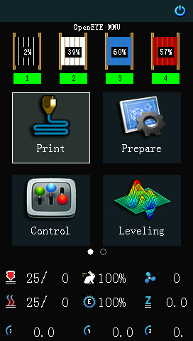 | [PNG](https://raw.githubusercontent.com/sezgynus/Petrel/master/docs/assets/screens/home.png) |
| MMU, Display, Maintenance ve Info simgeleri | 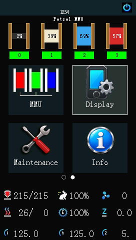 | [PNG](https://raw.githubusercontent.com/sezgynus/Petrel/master/docs/assets/screens/home-page-2.png) |
| Petrel açılışı ve ilerleme göstergesi | 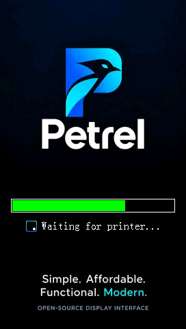 | [PNG](https://raw.githubusercontent.com/sezgynus/Petrel/master/docs/assets/screens/boot-splash.png) |

## Dosyalar ve baskı

| Ekran | Önizleme | Dış bağlantı |
|---|---|---|
| Klasörler ve G-code dosyaları | 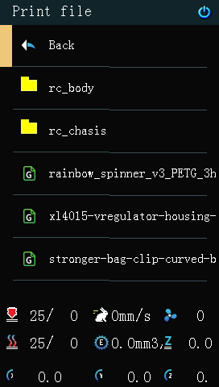 | [PNG](https://raw.githubusercontent.com/sezgynus/Petrel/master/docs/assets/screens/print-file.png) |
| Önizleme, bilgiler ve yazdırma onayı | 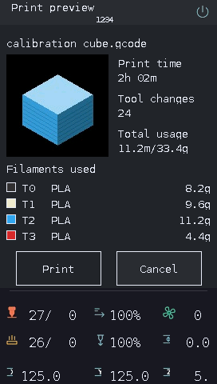 | [PNG](https://raw.githubusercontent.com/sezgynus/Petrel/master/docs/assets/screens/print-preview.png) |
| Baskı ilerlemesi, süre ve kontroller | 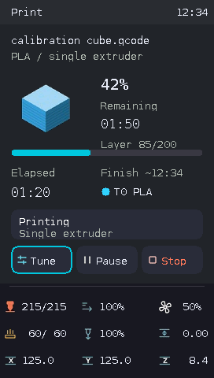 | [PNG](https://raw.githubusercontent.com/sezgynus/Petrel/master/docs/assets/screens/printing.png) |
| Duraklatılmış baskı ve Resume | 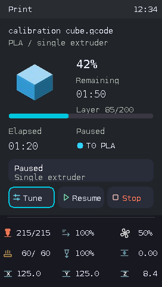 | [PNG](https://raw.githubusercontent.com/sezgynus/Petrel/master/docs/assets/screens/printing-paused.png) |
| Aktif filament ve Happy Hare durumu | 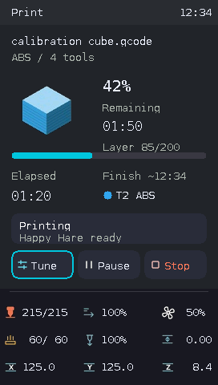 | [PNG](https://raw.githubusercontent.com/sezgynus/Petrel/master/docs/assets/screens/printing-mmu.png) |
| Kaynak ve hedef tool renkleri | 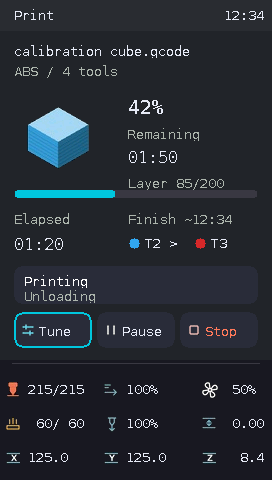 | [PNG](https://raw.githubusercontent.com/sezgynus/Petrel/master/docs/assets/screens/printing-toolchange.png) |
| MMU hatası ve kurtarmaya geçiş | 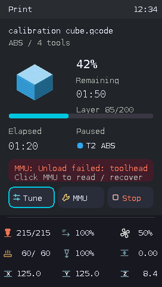 | [PNG](https://raw.githubusercontent.com/sezgynus/Petrel/master/docs/assets/screens/printing-mmu-error.png) |
| Tamamlanmış baskı ve Close kontrolü | 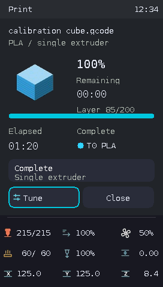 | [PNG](https://raw.githubusercontent.com/sezgynus/Petrel/master/docs/assets/screens/printing-complete.png) |
| Canlı baskı ayarları | 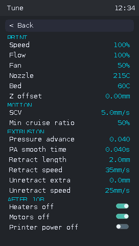 | [PNG](https://raw.githubusercontent.com/sezgynus/Petrel/master/docs/assets/screens/tune.png) |

## Yazıcı ve ekran kontrolleri

| Ekran | Önizleme | Dış bağlantı |
|---|---|---|
| Hazırlık | 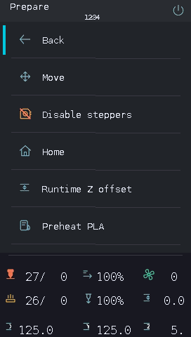 | [PNG](https://raw.githubusercontent.com/sezgynus/Petrel/master/docs/assets/screens/prepare.png) |
| Kontrol | 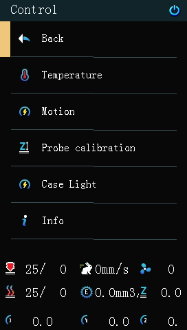 | [PNG](https://raw.githubusercontent.com/sezgynus/Petrel/master/docs/assets/screens/control.png) |
| Sıcaklık hedefleri | 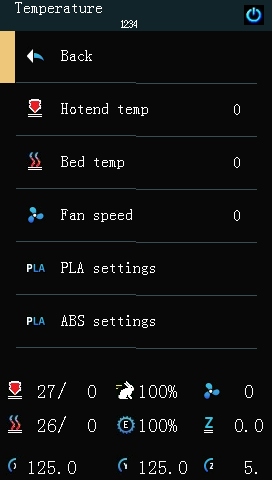 | [PNG](https://raw.githubusercontent.com/sezgynus/Petrel/master/docs/assets/screens/temperature.png) |
| Çalışma anındaki hareket ayarları | 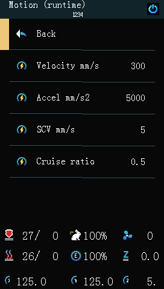 | [PNG](https://raw.githubusercontent.com/sezgynus/Petrel/master/docs/assets/screens/motion-runtime.png) |
| Live jog kapalı hareket menüsü | 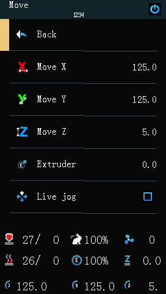 | [PNG](https://raw.githubusercontent.com/sezgynus/Petrel/master/docs/assets/screens/move.png) |
| Bakım menüsü | 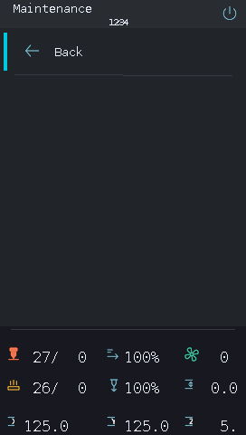 | [PNG](https://raw.githubusercontent.com/sezgynus/Petrel/master/docs/assets/screens/maintenance.png) |
| Parlaklık ve boşta karartma | 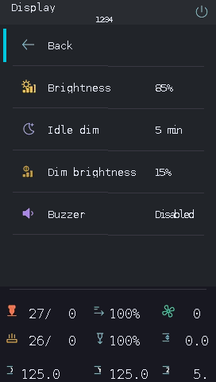 | [PNG](https://raw.githubusercontent.com/sezgynus/Petrel/master/docs/assets/screens/display.png) |
| Live jog açık hareket menüsü | 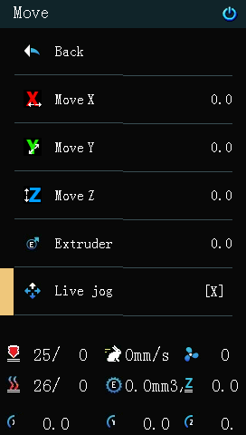 | [PNG](https://raw.githubusercontent.com/sezgynus/Petrel/master/docs/assets/screens/move-live-jog.png) |
| Ön ısıtma presetleri ve soğutma | 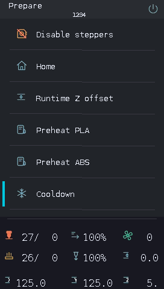 | [PNG](https://raw.githubusercontent.com/sezgynus/Petrel/master/docs/assets/screens/prepare-preheat.png) |
| Kasa ışığı açık |  | [PNG](https://raw.githubusercontent.com/sezgynus/Petrel/master/docs/assets/screens/case-light.png) |
| Kasa ışığı kapalı | 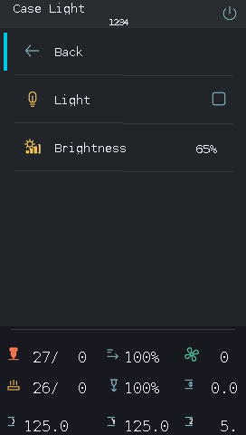 | [PNG](https://raw.githubusercontent.com/sezgynus/Petrel/master/docs/assets/screens/case-light-off.png) |
| Buzzer çıkışını seçme | 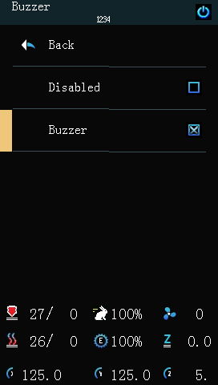 | [PNG](https://raw.githubusercontent.com/sezgynus/Petrel/master/docs/assets/screens/buzzer.png) |
| Ses seviyesi, tıklama ve enkoder tonları | 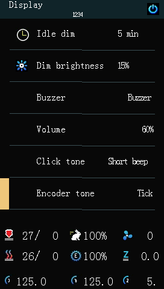 | [PNG](https://raw.githubusercontent.com/sezgynus/Petrel/master/docs/assets/screens/display-sound-settings.png) |
| Ses seviyesini düzenleme | 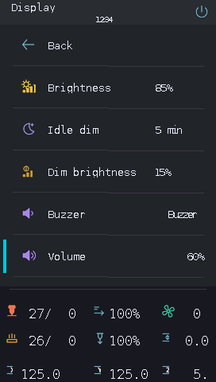 | [PNG](https://raw.githubusercontent.com/sezgynus/Petrel/master/docs/assets/screens/display-volume-edit.png) |
| Hotend hedefini düzenleme | 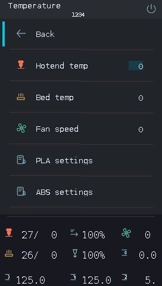 | [PNG](https://raw.githubusercontent.com/sezgynus/Petrel/master/docs/assets/screens/temperature-edit.png) |
| Ön ısıtma presetini düzenleme ve kaydetme | 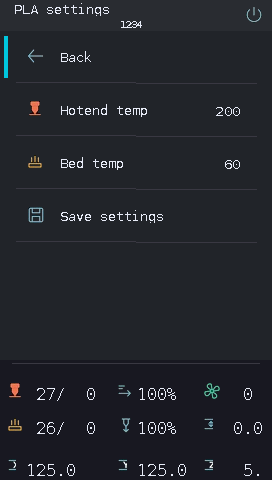 | [PNG](https://raw.githubusercontent.com/sezgynus/Petrel/master/docs/assets/screens/preheat-settings.png) |
| Yazıcıyı kapatma onayı | 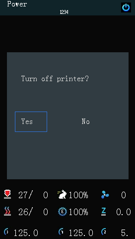 | [PNG](https://raw.githubusercontent.com/sezgynus/Petrel/master/docs/assets/screens/power-confirm.png) |

## Tabla ayarı ve kalibrasyon

| Ekran | Önizleme | Dış bağlantı |
|---|---|---|
| Tabla ayarı işlemleri | 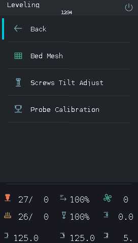 | [PNG](https://raw.githubusercontent.com/sezgynus/Petrel/master/docs/assets/screens/leveling.png) |
| Bed Mesh alt menüsü | 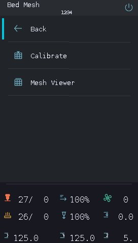 | [PNG](https://raw.githubusercontent.com/sezgynus/Petrel/master/docs/assets/screens/bed-mesh.png) |
| Mesh Viewer: default profili | 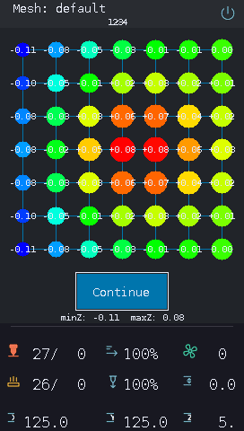 | [PNG](https://raw.githubusercontent.com/sezgynus/Petrel/master/docs/assets/screens/mesh-viewer.png) |
| Mesh Viewer: PEI profili | 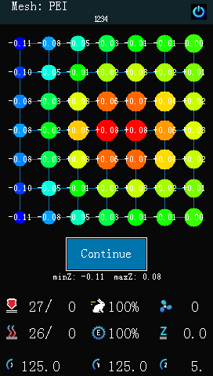 | [PNG](https://raw.githubusercontent.com/sezgynus/Petrel/master/docs/assets/screens/mesh-pei.png) |
| Tamamlanan ölçüm: Save veya Continue | 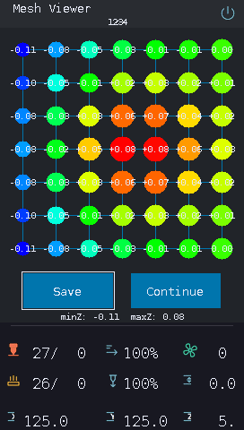 | [PNG](https://raw.githubusercontent.com/sezgynus/Petrel/master/docs/assets/screens/mesh-results.png) |
| Mesh kaydını ve Klipper yeniden başlatmasını onaylama | 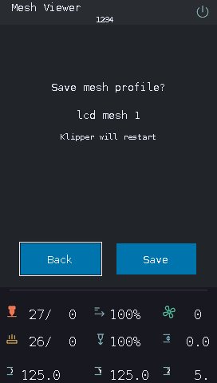 | [PNG](https://raw.githubusercontent.com/sezgynus/Petrel/master/docs/assets/screens/mesh-save-confirm.png) |
| Ölçüm sırasında acil durdurmayı onaylama | 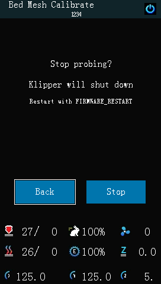 | [PNG](https://raw.githubusercontent.com/sezgynus/Petrel/master/docs/assets/screens/mesh-stop-confirm.png) |
| Kalibrasyon sırasında canlı prob sonuçları | 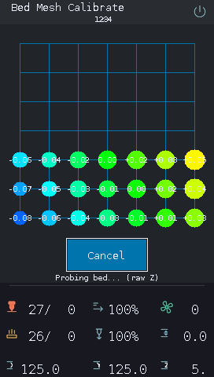 | [PNG](https://raw.githubusercontent.com/sezgynus/Petrel/master/docs/assets/screens/mesh-calibrating.png) |
| Geçerli ve kayıtlı mesh profilleri | 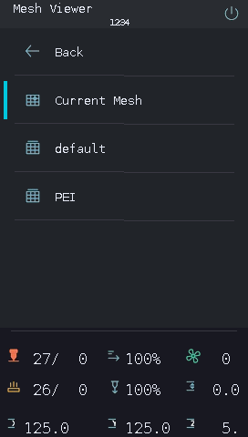 | [PNG](https://raw.githubusercontent.com/sezgynus/Petrel/master/docs/assets/screens/mesh-profiles.png) |
| Vida ayarlarını hesaplama | 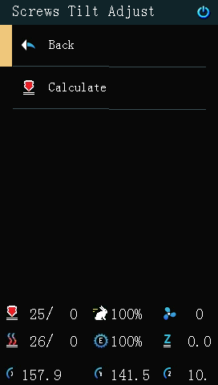 | [PNG](https://raw.githubusercontent.com/sezgynus/Petrel/master/docs/assets/screens/screws-tilt.png) |
| Vida köşelerini ölçme | 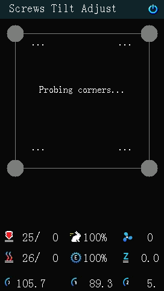 | [PNG](https://raw.githubusercontent.com/sezgynus/Petrel/master/docs/assets/screens/screws-tilt-probing.png) |
| Vida ölçümlerini okuma | 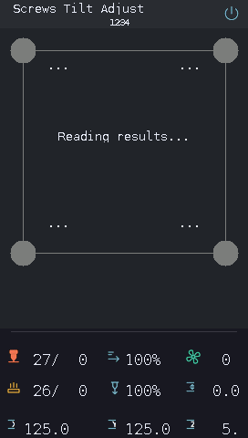 | [PNG](https://raw.githubusercontent.com/sezgynus/Petrel/master/docs/assets/screens/screws-tilt-reading-results.png) |
| Vida ayarında toleransa ulaşıldı | 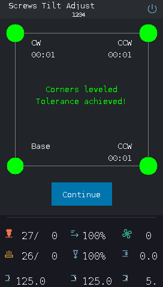 | [PNG](https://raw.githubusercontent.com/sezgynus/Petrel/master/docs/assets/screens/screws-tilt-success.png) |
| Gerekli manuel vida ayarı | 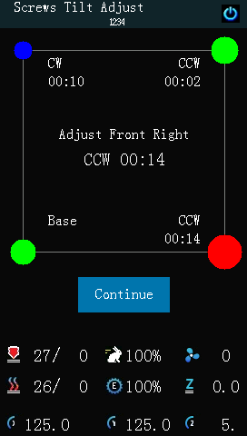 | [PNG](https://raw.githubusercontent.com/sezgynus/Petrel/master/docs/assets/screens/screws-tilt-adjust.png) |
| Prob kalibrasyonunu başlatma | 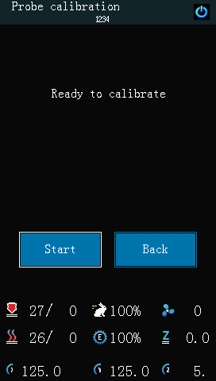 | [PNG](https://raw.githubusercontent.com/sezgynus/Petrel/master/docs/assets/screens/probe-calibration.png) |
| Dört kontrol ve canlı Z sınırları | 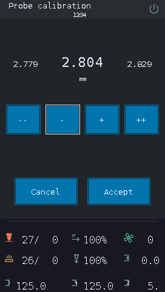 | [PNG](https://raw.githubusercontent.com/sezgynus/Petrel/master/docs/assets/screens/probe-calibration-active.png) |
| Offset kabulünden sonra kaydetme veya devam etme | 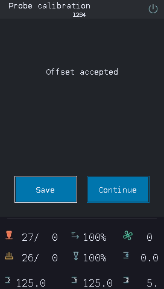 | [PNG](https://raw.githubusercontent.com/sezgynus/Petrel/master/docs/assets/screens/probe-calibration-accepted.png) |

## MMU ve filament

| Ekran | Önizleme | Dış bağlantı |
|---|---|---|
| EndlessSpool grup üyeliği | 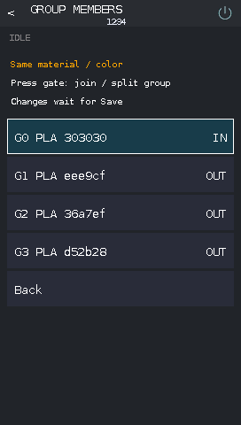 | [PNG](https://raw.githubusercontent.com/sezgynus/Petrel/master/docs/assets/screens/mmu-group-members.png) |
| Bir gate işlemini onaylama | 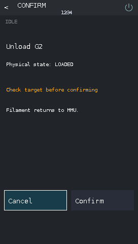 | [PNG](https://raw.githubusercontent.com/sezgynus/Petrel/master/docs/assets/screens/mmu-confirm.png) |
| MMU ünitelerine göz atma | 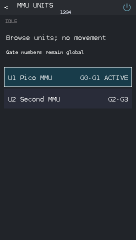 | [PNG](https://raw.githubusercontent.com/sezgynus/Petrel/master/docs/assets/screens/mmu-units.png) |
| Bir MMU ünitesinin gate listesi | 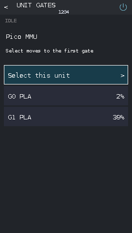 | [PNG](https://raw.githubusercontent.com/sezgynus/Petrel/master/docs/assets/screens/mmu-unit-gates.png) |
| Yüklü filament ve doğrudan araç kontrolleri |  | [PNG](https://raw.githubusercontent.com/sezgynus/Petrel/master/docs/assets/screens/mmu.png) |
| Ek MMU kontrolleri | 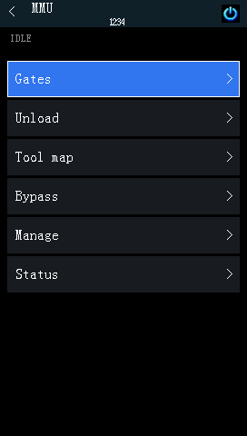 | [PNG](https://raw.githubusercontent.com/sezgynus/Petrel/master/docs/assets/screens/mmu-more.png) |
| Gate listesi |  | [PNG](https://raw.githubusercontent.com/sezgynus/Petrel/master/docs/assets/screens/mmu-gates.png) |
| Bir gate için işlemler |  | [PNG](https://raw.githubusercontent.com/sezgynus/Petrel/master/docs/assets/screens/mmu-gate-details.png) |
| Filament ve Spoolman bilgileri |  | [PNG](https://raw.githubusercontent.com/sezgynus/Petrel/master/docs/assets/screens/mmu-filament.png) |
| Makara ID atama |  | [PNG](https://raw.githubusercontent.com/sezgynus/Petrel/master/docs/assets/screens/mmu-spool.png) |
| Araç-gate eşlemesi |  | [PNG](https://raw.githubusercontent.com/sezgynus/Petrel/master/docs/assets/screens/mmu-tool-map.png) |
| EndlessSpool grupları |  | [PNG](https://raw.githubusercontent.com/sezgynus/Petrel/master/docs/assets/screens/mmu-endless-spool.png) |
| Yönetim ve kurtarma |  | [PNG](https://raw.githubusercontent.com/sezgynus/Petrel/master/docs/assets/screens/mmu-manage.png) |
| Sensörler ve MMU durumu |  | [PNG](https://raw.githubusercontent.com/sezgynus/Petrel/master/docs/assets/screens/mmu-status.png) |
| MMU bakım işlemleri |  | [PNG](https://raw.githubusercontent.com/sezgynus/Petrel/master/docs/assets/screens/mmu-maintenance.png) |
| MMU yapılandırma seçenekleri |  | [PNG](https://raw.githubusercontent.com/sezgynus/Petrel/master/docs/assets/screens/mmu-options.png) |
| MMU LED modları |  | [PNG](https://raw.githubusercontent.com/sezgynus/Petrel/master/docs/assets/screens/mmu-leds.png) |
| Ekstrüder ve bypass kontrolleri |  | [PNG](https://raw.githubusercontent.com/sezgynus/Petrel/master/docs/assets/screens/mmu-bypass.png) |
| Kurtarma işlemleri |  | [PNG](https://raw.githubusercontent.com/sezgynus/Petrel/master/docs/assets/screens/mmu-recovery.png) |
| Gerçek filament durumunu bildirme |  | [PNG](https://raw.githubusercontent.com/sezgynus/Petrel/master/docs/assets/screens/mmu-manual-state.png) |
| Bowden tüpünde ilerleyen filament |  | [PNG](https://raw.githubusercontent.com/sezgynus/Petrel/master/docs/assets/screens/mmu-loading.png) |
| Geri çekilen filament |  | [PNG](https://raw.githubusercontent.com/sezgynus/Petrel/master/docs/assets/screens/mmu-unloading.png) |
| Purge ve kalan filament rengi |  | [PNG](https://raw.githubusercontent.com/sezgynus/Petrel/master/docs/assets/screens/mmu-purging.png) |

## Sistem bilgileri ve güncellemeler

| Ekran | Önizleme | Dış bağlantı |
|---|---|---|
| Makine, ağ ve host |  | [PNG](https://raw.githubusercontent.com/sezgynus/Petrel/master/docs/assets/screens/info-overview.png) |
| Ana MCU ölçümleri |  | [PNG](https://raw.githubusercontent.com/sezgynus/Petrel/master/docs/assets/screens/info-mcu-details.png) |
| MMU MCU ve yazılım |  | [PNG](https://raw.githubusercontent.com/sezgynus/Petrel/master/docs/assets/screens/info-mcu-overview.png) |
| Kurulu yazılım sürümleri |  | [PNG](https://raw.githubusercontent.com/sezgynus/Petrel/master/docs/assets/screens/info-software.png) |
| Proje QR kodu ve updater |  | [PNG](https://raw.githubusercontent.com/sezgynus/Petrel/master/docs/assets/screens/info-project.png) |
| Güncellemeleri kontrol etme |  | [PNG](https://raw.githubusercontent.com/sezgynus/Petrel/master/docs/assets/screens/info-update-checking.png) |
| Yazılım güncel |  | [PNG](https://raw.githubusercontent.com/sezgynus/Petrel/master/docs/assets/screens/info-update-current.png) |
